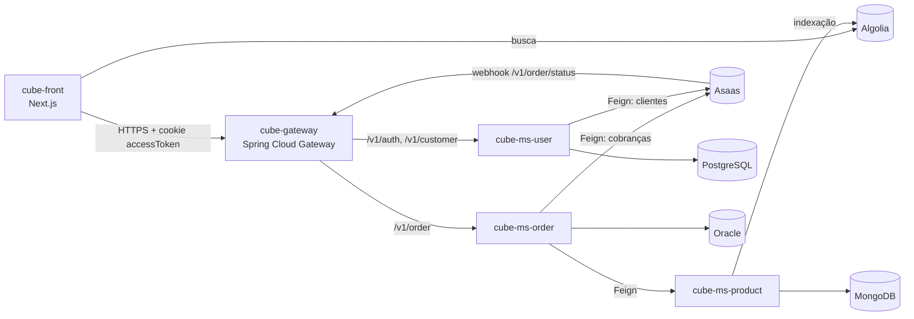

# cube-gateway

API Gateway do **Cube**, um e-commerce construído em microsserviços. Ele é o ponto único de entrada para o front-end: roteia as requisições para os serviços via Eureka, autentica o usuário a partir do cookie JWT e valida o webhook de pagamento do Asaas.

## Ecossistema Cube



Todos os serviços e o gateway se registram no **cube-ms-eureka**.

| Repositório | Papel | Stack |
| --- | --- | --- |
| [cube-front](https://github.com/MatheysJ/cube-front) | Loja (interface web) | Next.js, Chakra UI, Algolia |
| **cube-gateway** (este repositório) | API Gateway e autenticação JWT | Spring Cloud Gateway |
| [cube-ms-eureka](https://github.com/MatheysJ/cube-ms-eureka) | Descoberta de serviços | Netflix Eureka Server |
| [cube-ms-user](https://github.com/MatheysJ/cube-ms-user) | Usuários e login | Spring Boot, PostgreSQL |
| [cube-ms-product](https://github.com/MatheysJ/cube-ms-product) | Catálogo de produtos | Spring Boot, MongoDB, Algolia |
| [cube-ms-order](https://github.com/MatheysJ/cube-ms-order) | Pedidos e pagamentos | Spring Boot, Oracle, Asaas |
| [cube-admin](https://github.com/MatheysJ/cube-admin) | Painel administrativo (em planejamento) | - |

## Responsabilidades

- **Roteamento** para os microsserviços descobertos no Eureka (`lb://`).
- **Autenticação**: valida o JWT enviado no cookie `accessToken` antes de encaminhar a requisição.
- **Propagação de identidade**: injeta os headers `customer_id` e `asaas_customer_id` para os serviços internos, que não precisam validar o token de novo.
- **Webhook do Asaas**: autentica a chamada de confirmação de pagamento pelo header `asaas-access-token`.
- **CORS** para o front-end (`https://cube.matheus-junior.xyz`, com credenciais).

## Rotas

| Rota | Serviço de destino | Proteção |
| --- | --- | --- |
| `/v1/auth/**` | `CUBE-MS-USER` | Pública (registro, login, logout, validação de token) |
| `/v1/customer/**` | `CUBE-MS-USER` | JWT no cookie `accessToken` |
| `/v1/order/**` | `CUBE-MS-ORDER` | JWT no cookie `accessToken` |
| `/v1/order/status` | `CUBE-MS-ORDER` | Webhook do Asaas: header `asaas-access-token` |

O *discovery locator* do Spring Cloud Gateway também está habilitado.

### Fluxo de autenticação

1. O `AuthenticationFilter` lê o cookie `accessToken`.
2. Valida a assinatura HMAC (com `JWT_SECRET`, o mesmo segredo usado pelo `cube-ms-user`) e a expiração.
3. Extrai o `subject` (e-mail do usuário) e a claim `asaas_customer_id` e os repassa como headers `customer_id` e `asaas_customer_id`.
4. Responde `401 Unauthorized` se o cookie estiver ausente, o token for inválido ou estiver expirado.

## Tecnologias

- Java 21
- Spring Boot 3.4.5 e Spring Cloud 2024.0.1
- Spring Cloud Gateway (WebFlux) e Netflix Eureka Client
- JJWT 0.11.5 para validação do token
- Lombok e Spring Boot Actuator
- Docker (build multi-stage com Amazon Corretto) e deploy no Fly.io

## Variáveis de ambiente

| Variável | Obrigatória | Descrição |
| --- | --- | --- |
| `JWT_SECRET` | Sim | Segredo HMAC dos tokens. Deve ser igual ao do `cube-ms-user`. |
| `ASAAS_ACCESS_TOKEN` | Sim | Token configurado no webhook do Asaas, comparado com o header `asaas-access-token`. |
| `EUREKA_URL` | Não | URL do Eureka Server. Padrão: `https://cube-ms-eureka.onrender.com/eureka/`. |
| `PORT` | Não | Porta HTTP. Padrão: `8080`. |

## Como executar

Pré-requisitos: JDK 21+ e um Eureka Server acessível (veja o [cube-ms-eureka](https://github.com/MatheysJ/cube-ms-eureka)).

```bash
export JWT_SECRET="<mesmo segredo do cube-ms-user>"
export ASAAS_ACCESS_TOKEN="<token do webhook>"
export EUREKA_URL="http://localhost:8761/eureka/"

./mvnw spring-boot:run   # no Windows: mvnw.cmd spring-boot:run
```

O gateway sobe em `http://localhost:8080`. O `cube-ms-user` também usa a porta 8080 por padrão, então defina `PORT` (por exemplo `PORT=8000`) ao rodar os dois na mesma máquina.

### Docker

```bash
docker build -t cube-gateway .
docker run -p 8080:8080 \
  -e JWT_SECRET="..." \
  -e ASAAS_ACCESS_TOKEN="..." \
  -e EUREKA_URL="http://host.docker.internal:8761/eureka/" \
  cube-gateway
```

### Deploy no Fly.io

O repositório inclui `fly.toml` (app `cube-gateway`, região `gru`, 1 vCPU e 1 GB, com parada automática das máquinas ociosas).

```bash
fly secrets set JWT_SECRET="..." ASAAS_ACCESS_TOKEN="..."
fly deploy
```

## Estrutura

```
src/main/java/com/cube/gateway
├── filters/       # AuthenticationFilter (JWT + webhook) e RouteValidator
├── exceptions/    # Tratamento de erros e respostas padronizadas
├── enums/         # Códigos e mensagens de erro
└── dtos/          # DTOs de validação de token
src/main/resources/application.yaml   # rotas, CORS e Eureka
```

## Autor

Desenvolvido por [@MatheysJ](https://github.com/MatheysJ).
